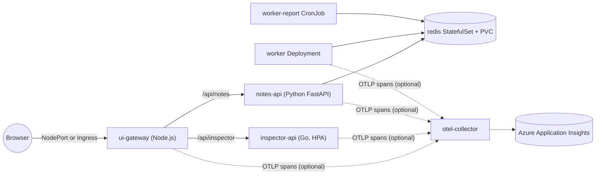

# k8s-demo-sample-app (KubePlay)

Demo app for demonstrating Kubernetes concepts.

KubePlay is a small polyglot microservice system inspired by httpbin, but every endpoint is designed to make a Kubernetes concept visible — in the terminal and in a live web dashboard.



## Services

| Service | Stack | What it does |
| --- | --- | --- |
| [ui-gateway](services/ui-gateway) | Node.js 22, zero deps | Dashboard + reverse proxy (`/api/inspector/*`, `/api/notes/*`, `/api/gateway/*`) |
| [inspector-api](services/inspector-api) | Go 1.23, distroless | httpbin-like, Kubernetes-aware endpoints |
| [notes-api](services/notes-api) | Python 3.12, FastAPI | Notes CRUD in Redis, job queue, Swagger at `/api/notes/docs` |
| [worker](services/worker) | Python 3.12 | Queue consumer, scheduled report, seeder |
| redis | redis:7.4-alpine | Storage and queue |
| otel-collector (optional) | otel/opentelemetry-collector-contrib | Receives OTLP spans and exports them to Application Insights |

## Dashboard

Open the UI (Compose: <http://localhost:3000>, kind: <http://localhost:8088>):

| Panel | What it shows |
| --- | --- |
| Header | Platform badge (Docker Compose / Kubernetes + namespace), health chips for gateway, inspector, notes, Redis, and the gateway pod |
| Pod fleet | One tile per inspector-api pod: version/colour, node, pod IP, namespace, service account, limits, uptime and share of traffic |
| Chaos & load | Readiness/liveness failures, crash, CPU and memory stress, slow and error responses |
| Request explorer | httpbin-style requests to any inspector endpoint with status, latency, content type and a copyable cURL command |
| Service health | Upstream readiness and latency from `GET /api/gateway/status`, mapped to K8s concepts |
| Notes / Jobs | Redis-backed notes (shows which pod wrote them) and worker job results |
| Activity log | Every action with status, latency, the pod that handled it and (with tracing on) the trace ID |

The gateway opens a new upstream connection per request (no keep-alive), so the pod fleet shows real Service load balancing. On Docker Compose, Docker DNS round-robins across the 3 inspector replicas; node, pod IP, namespace and service account show `–` because they come from the Kubernetes Downward API.

## Inspector API

| Endpoint | Purpose |
| --- | --- |
| `GET /whoami` | Pod, namespace, node, IP, service account, limits (Downward API) |
| `GET /headers`, `/ip`, `/env` | Request headers, client IP, environment (secrets masked) |
| `GET /config`, `/secret` | Mounted ConfigMap (hot reload) and Secret (masked) |
| `ANY /status/{code}`, `/delay/{s}`, `/anything[/{path}]` | httpbin-style helpers |
| `GET /livez`, `/readyz`, `/startupz` | Probe endpoints |
| `POST /chaos/ready`, `/chaos/live`, `/chaos/crash` | Break probes / exit the process |
| `POST /stress/cpu`, `POST\|DELETE /stress/memory` | Trigger HPA scale-out or OOMKilled |
| `GET /metrics` | Prometheus text format |

## Concept map

| Kubernetes concept | Where to see it |
| --- | --- |
| Deployments, ReplicaSets, rolling update / rollback | `inspector-api` colour + version tiles in UI |
| Services, DNS, load balancing | Pod fleet hit share; gateway calls `http://inspector-api` |
| Readiness / liveness / startup probes | `POST /chaos/ready`, `/chaos/live`, `STARTUP_DELAY_SECONDS` |
| CrashLoopBackOff | `POST /chaos/crash` |
| Resource requests/limits, OOMKilled | `POST /stress/memory?mb=300` (limit 256Mi) |
| HorizontalPodAutoscaler | `POST /stress/cpu` |
| PodDisruptionBudget, graceful shutdown | `kubectl drain`, SIGTERM drain logs |
| Downward API | `GET /whoami` (pod, node, IP, SA, limits) |
| ConfigMap (env vs volume hot reload), Secret | `GET /config`, `GET /secret` |
| StatefulSet, headless Service, PVC | `redis-0`, `data-redis-0` |
| Init containers | `notes-api` waits for Redis |
| Dependency-aware readiness | `notes-api /readyz` pings Redis; Service health panel |
| Job, CronJob | `seed-notes`, `worker-report` |
| Exec probe, emptyDir | `worker` heartbeat liveness |
| NetworkPolicy | Only allowed pods reach Redis / notes-api |
| Pod Security Admission, securityContext | Namespace labels, non-root read-only containers |
| Ingress / NodePort | AKS app routing / kind port mapping |
| Distributed tracing (OpenTelemetry → Application Insights) | `otel-collector`, `traceparent` in `GET /headers`, trace IDs in the activity log and job results |

Step-by-step scenarios: [demos/README.md](demos/README.md).

## Quick start

### Docker Compose (no Kubernetes)

```sh
make compose-up     # UI: http://localhost:3000
make compose-down   # stop and remove volumes
```

Runs 3 inspector-api replicas (host ports 8080–8082), notes-api on 8000, Redis and the worker.

### kind (local Kubernetes)

```sh
make kind-up            # 3-node cluster + metrics-server
make deploy-kustomize   # pulls kasunsjc/kubeplay-*:0.1.1 from Docker Hub
open http://localhost:8088
make kind-destroy       # delete the cluster and local kubeplay images
```

The local overlay uses the Docker Hub images, which must include `linux/arm64` on Apple Silicon (`make dockerhub-push DOCKERHUB_USER=kasunsjc PLATFORMS=linux/amd64,linux/arm64`). To test unpushed code instead, use `make kind-load deploy-helm` (Helm `values-local.yaml` still uses locally built `kubeplay/*:dev` images).

Minikube / Docker Desktop: build with `make build` into the cluster's Docker daemon, deploy, then `kubectl port-forward svc/ui-gateway 8088:80 -n kubeplay`.

### AKS

Requires an AKS cluster attached to an ACR (`az aks update --attach-acr`) with the app routing add-on (`az aks approuting enable`).

```sh
make aks-push ACR=myacr                    # builds images in ACR
make aks-deploy-kustomize ACR=myacr        # or: make aks-deploy-helm ACR=myacr
kubectl get ingress kubeplay -n kubeplay   # open the ADDRESS
```

### Distributed tracing with Application Insights

Every service emits OpenTelemetry spans so one click in the dashboard becomes a single end-to-end trace — browser → `ui-gateway` → `inspector-api` / `notes-api` → Redis → `worker` (the W3C `traceparent` travels in HTTP headers and inside queued jobs). Spans go over OTLP/HTTP to an OpenTelemetry Collector, whose `azure_monitor` exporter sends them to Application Insights, ready for the [Azure Monitor traces / Trace Analytics preview](https://learn.microsoft.com/en-us/azure/azure-monitor/app/traces-overview).

| Service | Instrumentation |
| --- | --- |
| ui-gateway | Built-in (`tracing.js`, no deps): SERVER + CLIENT span per proxied call, `x-trace-id` response header |
| inspector-api | Built-in (`tracing.go`, stdlib only): SERVER span per request, `X-Trace-Id` response header |
| notes-api | OpenTelemetry SDK with FastAPI + Redis instrumentation; injects the trace context into jobs |
| worker | OpenTelemetry SDK with Redis instrumentation; CONSUMER span continues the job's trace, `traceId` in results |

Tracing is off unless `OTEL_EXPORTER_OTLP_ENDPOINT` is set. Probes, idle queue polling and the dashboard's pod-fleet polling are not traced. Each span carries `service.name` (Application Insights role name), `service.instance.id`/`k8s.pod.name` (role instance), namespace and node.

1. Create an Application Insights resource and copy its connection string.
2. Deploy with tracing (the connection string is stored in the `appinsights` Secret, never in the repo):

   ```sh
   export APPINSIGHTS_CONNECTION_STRING='InstrumentationKey=...;IngestionEndpoint=...'
   make aks-push ACR=myacr                  # images must include the instrumentation
   make aks-deploy-kustomize ACR=myacr      # uses overlays/aks-tracing; or: make aks-deploy-helm ACR=myacr
   make compose-tracing                     # alternative: run locally with Docker Compose
   ```

   Other clusters: `make appinsights-secret`, then add the `deploy/kustomize/components/tracing` component to an overlay or set `tracing.enabled=true` in Helm.
3. [Onboard the Application Insights resource to Azure Monitor traces](https://learn.microsoft.com/en-us/azure/azure-monitor/app/traces-onboard-app-insights) (link it to an Azure Monitor workspace, *Monitoring → Traces*), click around the dashboard, then search for the trace IDs shown in the activity log.

`kubectl logs deploy/otel-collector -n kubeplay` shows how many spans the collector forwards.

### Docker Hub

```sh
docker login
make dockerhub-push DOCKERHUB_USER=<user>                                   # linux/amd64, tags 0.1.1 + latest
make dockerhub-push DOCKERHUB_USER=<user> PLATFORMS=linux/amd64,linux/arm64 # multi-arch
```

Images are pushed as `<user>/kubeplay-<service>`. A temporary buildx builder is created and removed after the push (`make buildx-clean` if a push was interrupted).

## CI/CD

[.github/workflows/dockerhub.yml](.github/workflows/dockerhub.yml) runs after a merged `release/x.y.z` or `hotfix/x.y.z` PR to `main`, or manually from `main` via *Run workflow* with a version input:

1. Runs all unit tests (Go, pytest, node).
2. Builds each service for `linux/amd64` + `linux/arm64` and pushes `<user>/kubeplay-<service>` with SemVer tags (`x.y.z`, `x.y`, `x`), `latest`, and `sha-<commit>`.
3. Creates a GitHub Release and `v<x.y.z>` tag after all images publish successfully.

Repository settings required (*Settings → Secrets and variables → Actions*):

| Name | Type | Value |
| --- | --- | --- |
| `DOCKERHUB_USERNAME` | Secret | Docker Hub username (e.g. `kasunsjc`) |
| `DOCKERHUB_TOKEN` | Secret | Docker Hub access token (Read & Write) |

The workflow uses the built-in `GITHUB_TOKEN` to create releases. For manual runs, select the `main` branch and enter a version such as `1.2.3`.

## Branching (Git Flow)

| Branch | From | Merges into |
| --- | --- | --- |
| `feature/*`, `bugfix/*` | `develop` | `develop` |
| `release/x.y.z` | `develop` | `main` and `develop` |
| `hotfix/x.y.z` | `main` | `main` and `develop` |

`main` only receives release and hotfix merges. A merged `release/x.y.z` or `hotfix/x.y.z` PR publishes versioned images and creates the matching `v<x.y.z>` GitHub Release. Commits use Conventional Commits (`feat:`, `fix:`, `docs:` …). Details: [.github/skills/git-flow/SKILL.md](.github/skills/git-flow/SKILL.md).

## Architectures (Apple Silicon)

| Target | Images | Arch |
| --- | --- | --- |
| kind on your Mac | `make kind-load` (built locally) | native (arm64) |
| AKS / EKS / GKE | `make dockerhub-push` or `make aks-push` | amd64 |
| Both from one registry | `PLATFORMS=linux/amd64,linux/arm64` | multi-arch |

Don't run amd64-only registry images on kind on Apple Silicon — they fail with `no match for platform` or `exec format error`.

## Make targets

| Target | Description |
| --- | --- |
| `make help` | List targets |
| `make test` / `make lint` | Unit tests for all services / Helm lint + Kustomize render |
| `make build` | Build `kubeplay/<svc>:dev` for the local Docker arch |
| `make compose-up` / `compose-down` | Run / stop everything with Docker Compose |
| `make compose-tracing` | Docker Compose plus the OpenTelemetry Collector sending traces to Application Insights (`APPINSIGHTS_CONNECTION_STRING=...`) |
| `make kind-up` / `kind-down` / `kind-destroy` | Create / delete the kind cluster (destroy also removes images) |
| `make kind-load` | Build and load images into kind |
| `make metrics-server` | Install metrics-server (needed by HPA) |
| `make deploy-kustomize` / `undeploy-kustomize` | Apply / delete the local Kustomize overlay |
| `make deploy-helm` / `undeploy-helm` | Install / uninstall the Helm chart with `values-local.yaml` |
| `make aks-push` / `aks-deploy-kustomize` / `aks-deploy-helm` | Build in ACR and deploy to AKS (`ACR=<name>`; adds tracing when `APPINSIGHTS_CONNECTION_STRING` is set) |
| `make appinsights-secret` | Create/update the `appinsights` Secret holding the Application Insights connection string |
| `make dockerhub-push` / `buildx-clean` | Push to Docker Hub (`DOCKERHUB_USER=<user>`) / remove leftover builder |

## Development

```sh
make test     # go test, pytest, node --test
make lint     # helm lint + kustomize render
```

Python tests need `pip install -r requirements-dev.txt` in each Python service.

Copilot customizations live in `.github/`: project instructions, per-language `instructions/`, and skills (`add-k8s-concept`, `deploy-kubeplay`, `run-demo`, `readme-check`, `git-flow`).

## Troubleshooting

| Symptom | Fix |
| --- | --- |
| `failed to lock config file: ~/.kube/config.lock` | Stale lock: `rm ~/.kube/config.lock && kind export kubeconfig --name kubeplay` |
| `CreateContainerConfigError: non-numeric user` | Dockerfile `USER` must be numeric (e.g. `65532`) |
| `Multi-platform build is not supported for the docker driver` | Use `make dockerhub-push` (creates a docker-container builder) |
| HPA shows `cpu: <unknown>` | `make metrics-server` and wait ~60s |

## Layout

```text
services/            source + Dockerfile per microservice
deploy/kustomize/    base + overlays/{local,aks,aks-tracing} + components/tracing
deploy/helm/kubeplay Helm chart (values-local.yaml, values-aks.yaml)
deploy/kind/         kind cluster config
deploy/compose/      files mounted by docker-compose
demos/               demo scenarios and extra manifests
.github/             Copilot instructions, skills and the Docker Hub workflow
```

> Secrets in this repo are demo values only.
