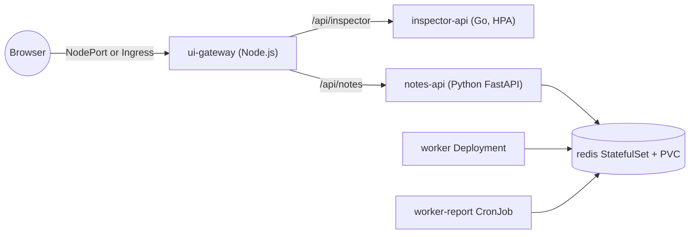

# k8s-demo-sample-app (KubePlay)
Demo app for demonstrating kubernetes concepts.

KubePlay is a small polyglot microservice system inspired by httpbin, but every endpoint is designed to make a Kubernetes concept visible — in the terminal and in a live web dashboard.



## Services

| Service | Stack | What it does |
|---|---|---|
| [ui-gateway](services/ui-gateway) | Node.js 22, zero deps | Dashboard (pod fleet, chaos buttons, notes, jobs) + reverse proxy |
| [inspector-api](services/inspector-api) | Go 1.23, distroless | httpbin-like, Kubernetes-aware endpoints |
| [notes-api](services/notes-api) | Python 3.12, FastAPI | Notes CRUD in Redis, job queue, Swagger at `/api/notes/docs` |
| [worker](services/worker) | Python 3.12 | Queue consumer, scheduled report, seeder |
| redis | redis:7.4-alpine | Storage and queue |

## Concept map

| Kubernetes concept | Where to see it |
|---|---|
| Deployments, ReplicaSets, rolling update / rollback | `inspector-api` colour + version tiles in UI |
| Services, DNS, load balancing | Pod fleet hit distribution; gateway calls `http://inspector-api` |
| Readiness / liveness / startup probes | `POST /chaos/ready`, `/chaos/live`, `STARTUP_DELAY_SECONDS` |
| CrashLoopBackOff | `POST /chaos/crash` |
| Resource requests/limits, OOMKilled | `POST /stress/memory?mb=300` (limit 256Mi) |
| HorizontalPodAutoscaler | `POST /stress/cpu` |
| PodDisruptionBudget, graceful shutdown | `kubectl drain`, SIGTERM drain logs |
| Downward API | `GET /whoami` (pod, node, IP, SA, limits) |
| ConfigMap (env vs volume hot reload), Secret | `GET /config`, `GET /secret` |
| StatefulSet, headless Service, PVC | `redis-0`, `data-redis-0` |
| Init containers | `notes-api` waits for Redis |
| Dependency-aware readiness | `notes-api /readyz` pings Redis |
| Job, CronJob | `seed-notes`, `worker-report` |
| Exec probe, emptyDir | `worker` heartbeat liveness |
| NetworkPolicy | Only allowed pods reach Redis / notes-api |
| Pod Security Admission, securityContext | Namespace labels, non-root read-only containers |
| Ingress / NodePort | AKS app routing / kind port mapping |

Step-by-step scenarios: [demos/README.md](demos/README.md).

## Quick start

### Docker Compose (no Kubernetes)
```sh
docker compose up --build      # UI: http://localhost:3000
```

### kind (local Kubernetes)
```sh
make kind-up                   # 3-node cluster + metrics-server
make kind-load                 # build images and load into kind
make deploy-kustomize          # or: make deploy-helm
open http://localhost:8088
```
Minikube / Docker Desktop: build images with `make build` into the cluster's Docker daemon, deploy, then `kubectl port-forward svc/ui-gateway 8088:80 -n kubeplay`.

### AKS
Requires an AKS cluster attached to an ACR (`az aks update --attach-acr`) with the app routing add-on (`az aks approuting enable`).
```sh
make aks-push ACR=myacr                    # builds images in ACR
make aks-deploy-kustomize ACR=myacr        # or: make aks-deploy-helm ACR=myacr
kubectl get ingress kubeplay -n kubeplay   # open the ADDRESS
```

## Development
```sh
make test     # go test, pytest, node --test
make lint     # helm lint + kustomize render
```
Python tests need `pip install -r requirements-dev.txt` in each Python service.

## Layout
```
services/            source + Dockerfile per microservice
deploy/kustomize/    base + overlays/{local,aks}
deploy/helm/kubeplay Helm chart (values-local.yaml, values-aks.yaml)
deploy/kind/         kind cluster config
demos/               demo scenarios and extra manifests
```

> Secrets in this repo are demo values only.
